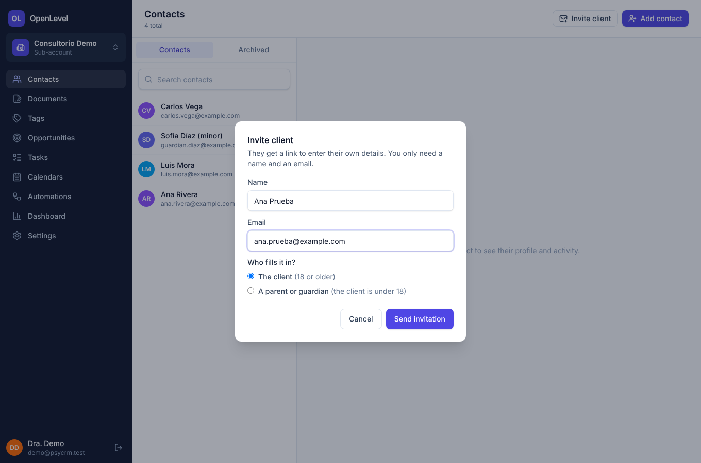
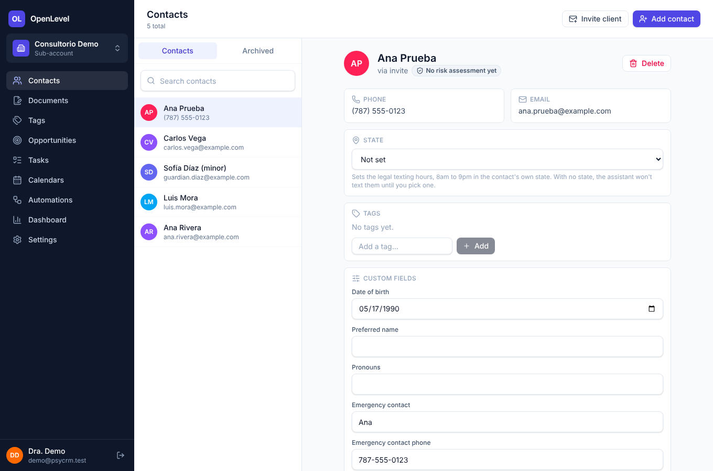
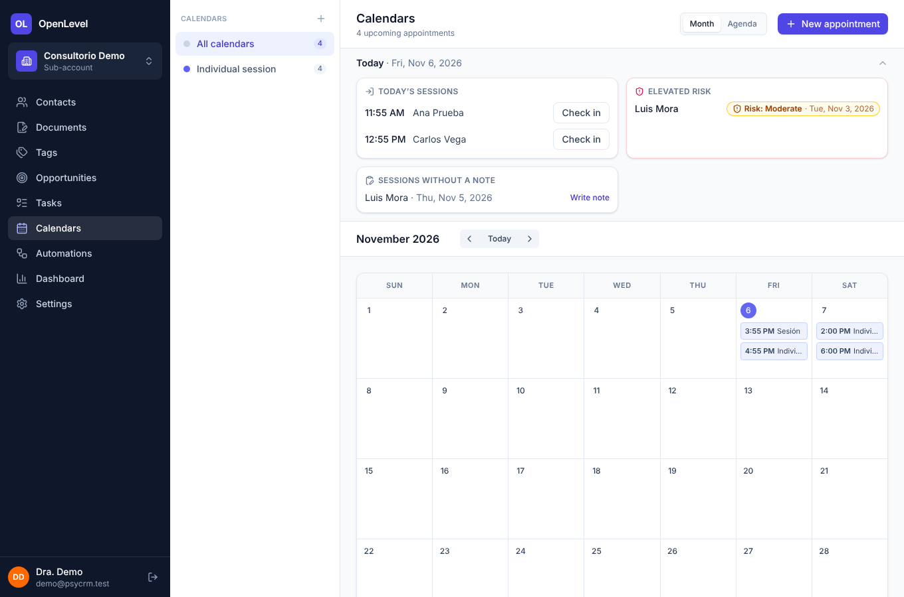
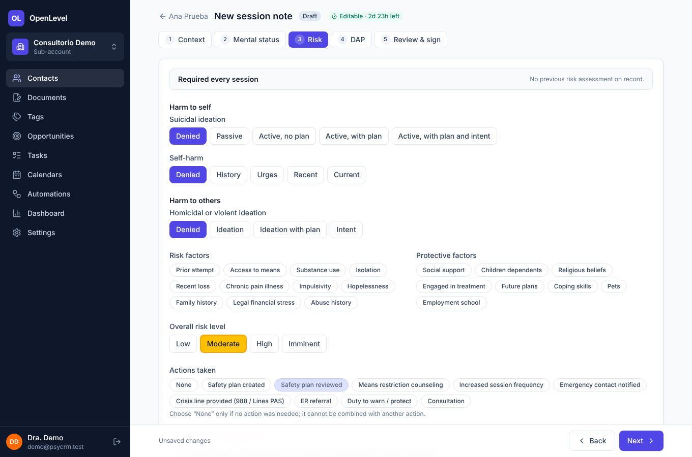
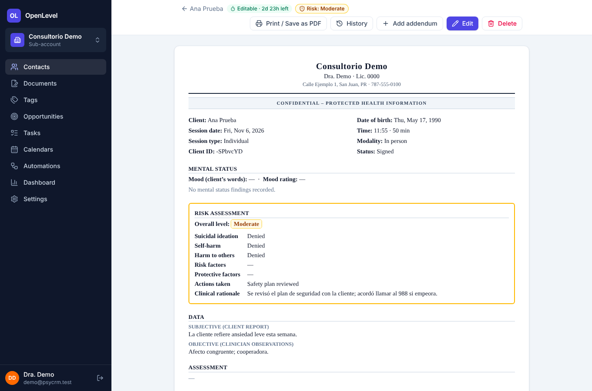
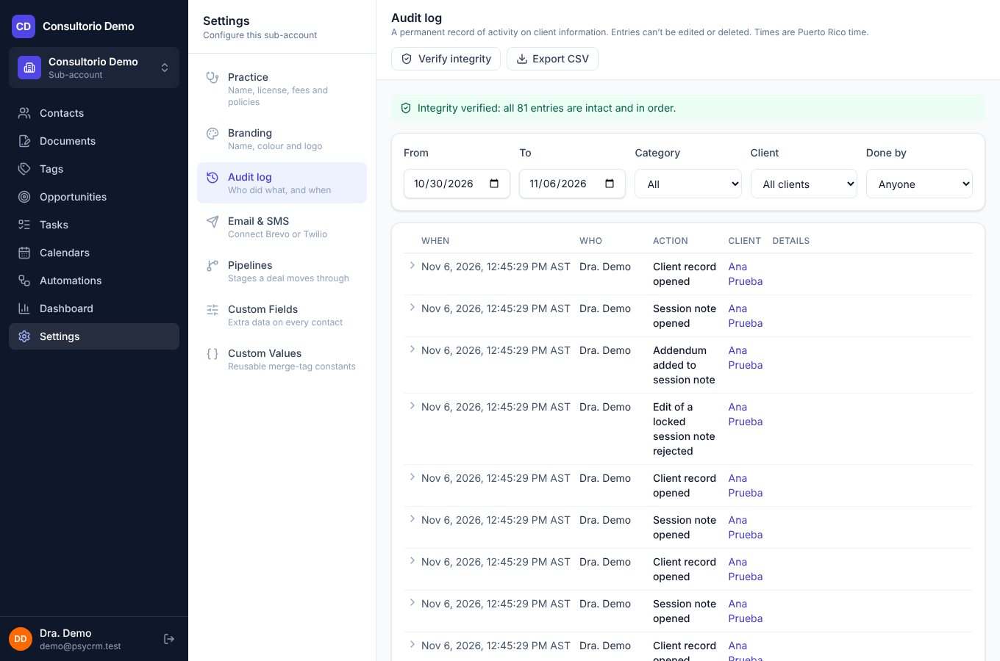

# Guía rápida para la terapeuta

PsyCRM en una página. Las pantallas están en inglés; las páginas que ve su cliente están en español. Las capturas son de un cliente ficticio ("Ana Prueba").

## 1. Un cliente nuevo
**Contacts → Invite client.** Escriba el nombre y el correo, y elija quién llena el registro: **el cliente** (18 años o más) o **un padre, madre o tutor** (si el cliente es menor).

- La persona recibe un enlace, escribe sus propios datos (incluida la fecha de nacimiento) y **entonces** se crea el cliente.
- Enseguida le llegan los **documentos para firmar** (consentimiento, privacidad, cancelación, honorarios, comunicaciones y cuestionario), desde su celular y con la firma dibujada. A un menor se le envían los del tutor.
- En la lista de contactos, **Invitations** muestra las invitaciones pendientes (Sent, Opened, Expired) con **Resend** y **Cancel**.
- Si prefiere crear el cliente usted misma: **Add contact** (pide la fecha de nacimiento; deje marcada "Send onboarding packet now" para que los documentos salgan solos).

Para seguir el progreso, abra al cliente y mire **Documents**: ve qué documentos firmó cada persona, y puede **Resend** (enlace nuevo) o **Void** (anular).

La tarjeta del cliente en **Opportunities** avanza sola: New contact → Documents sent → Documents signed → First appointment booked → Active client. Si usted la mueve a mano, el sistema respeta su decisión y no la devuelve atrás.

## 2. Un cliente menor de 18 años
Use **Invite client → A parent or guardian**. El tutor llena los datos del paciente y los suyos. El paquete (con el consentimiento del tutor) sale a su correo. Si lo prefiere, entre la fecha de nacimiento y los datos del tutor (campos *Guardian*) y use **Send onboarding packet** en la ficha: se preselecciona el paquete **Adolescent**.

## 3. El día de la sesión
**Calendars:** el panel **Today** muestra las sesiones de hoy. Toque **Check in** cuando llegue el cliente y luego **Start note**: la nota se abre con la cita ya cargada.

El panel también le avisa de **riesgo elevado**, de **notas por bloquearse** y de **sesiones sin nota**.

## 4. La nota (5 pasos)
Contexto → Estado mental → **Riesgo** → DAP → Revisar y firmar.

- **El riesgo es obligatorio en cada sesión** (ideación suicida, autolesión, daño a otros y nivel general). Sin él no se puede firmar.
- Con riesgo **moderado o mayor** hace falta una justificación y al menos una acción, y el sistema le crea una tarea de seguimiento.
- Se guarda sola mientras escribe. Puede corregir la nota durante **72 horas desde que la creó**; **después ya no se puede corregir ni borrar: solo admite anexos** (Add addendum). Aun una nota que borre dentro de esas 72 horas conserva su historia en el registro.

## 5. Imprimir o exportar una nota
Abra la nota → **Print / Save as PDF** y elija "Guardar como PDF".

## 6. Ver qué pasó
**Settings → Audit log** muestra quién hizo qué y cuándo (clientes creados, notas, documentos, movimientos del pipeline). **Verify integrity** comprueba que el registro no fue alterado. En la ficha de cada cliente hay una sección **Audit** con su propia historia.

## 7. Su marca
**Settings → Branding:** ponga el nombre de su consultorio, elija su color y suba su logo (PNG, JPEG o WebP, hasta 300 KB). Cambia al instante en la aplicación y en las páginas y los correos que recibe su cliente. El nombre legal de **Settings → Practice** (el de los documentos y las notas impresas) no cambia.

## 8. Si algo falla
- **El cliente no recibió el correo:** pídale que revise "spam"; en **Documents** o **Invitations** use **Resend**. Si el correo no está configurado, el sistema le muestra el enlace para que lo envíe usted (**Copy link**).
- **"Este enlace no es válido o expiró":** pasan 14 días, se anuló o ya se usó. Use **Resend**.
- **Un paquete queda "Needs your review":** la fecha de nacimiento que el cliente escribió no coincide con la del expediente. Revísela; si está bien, **Accept as complete**.
- **Cambiar mi contraseña:** *Settings → Account*. Pide la actual y la nueva (12 caracteres o más), y cierra la sesión en los demás dispositivos. Mientras la contraseña sea la que se le entregó al crear la cuenta, aparece un aviso amarillo arriba con el enlace.
- **Olvidé mi contraseña:** pida al administrador que la cambie (no se envía por correo; todavía no hay recuperación automática).
- **Algo no cuadra con una nota o un documento:** no lo corrija "a mano": use un anexo y avise al administrador.

**Si un cliente está en crisis:** llame al **988** o al **911**. Estos números aparecen también en el paso de Riesgo y en los documentos (y deben verificarse antes de usar el sistema con clientes).
